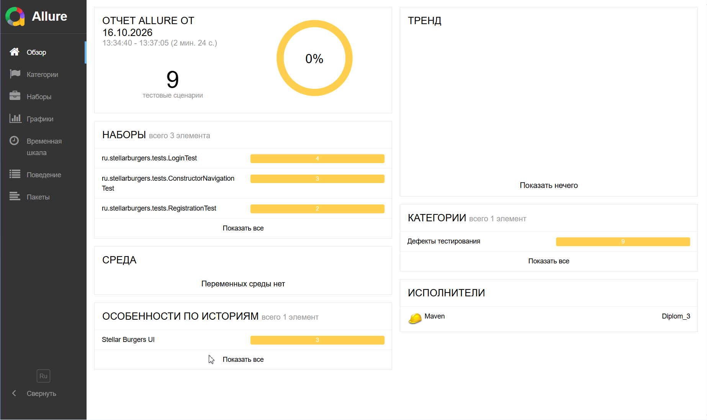
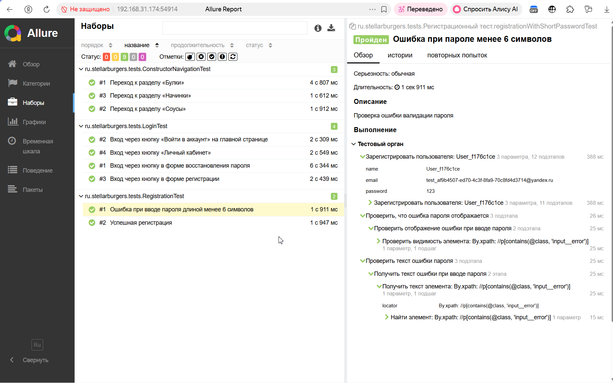

# Diplom_3: UI-автотесты для Stellar Burgers

Проект автоматизации UI-тестирования приложения Stellar Burgers на Java 11 с использованием Selenium WebDriver, JUnit 4, Allure и паттерна Page Object.

## Стек технологий

- **Java 11** — язык программирования
- **Selenium WebDriver 4.25.0** — управление браузером
- **JUnit 4.13.2** — фреймворк для тестирования
- **REST Assured 5.5.5** — API-предусловия (создание/удаление юзера)
- **Allure 2.27.0** — отчётность
- **Lombok 1.18.34** — генерация кода
- **Jackson 2.17.1** — работа с JSON
- **WebDriverManager 5.9.2** — автоустановка ChromeDriver
- **Maven** — сборка проекта

## Структура проекта

```text
src/test/java/ru/stellarburgers/
├── api/
│   └── UserApiClient.java              — API-клиент (регистрация/удаление юзера)
├── base/
│   ├── BasePage.java                   — базовый Page Object
│   └── BaseUiTest.java                 — базовый тест-класс
├── constants/
│   └── Config.java                     — URL-адреса и константы
├── models/
│   └── UserModel.java                  — модель пользователя
├── pages/
│   ├── MainPage.java                   — Page Object главной страницы
│   ├── LoginPage.java                  — Page Object входа
│   ├── RegisterPage.java               — Page Object регистрации
│   ├── ForgotPasswordPage.java         — Page Object восстановления пароля
│   └── ConstructorPage.java            — Page Object конструктора бургеров
├── steps/
│   ├── ConstructorSteps.java           — Steps для конструктора
│   ├── ForgotPasswordSteps.java        — Steps для восстановления пароля
│   ├── HomeSteps.java                  — Steps для главной страницы
│   ├── LoginSteps.java                 — Steps для входа
│   └── RegisterSteps.java              — Steps для регистрации
├── tests/
│   ├── RegistrationTest.java           — 2 теста регистрации
│   ├── LoginTest.java                  — 4 теста входа
│   └── ConstructorNavigationTest.java  — 3 теста конструктора
└── utils/
    ├── BrowserFactory.java             — фабрика браузеров (Chrome, Яндекс)
    └── TestDataGenerator.java          — генерация тестовых данных
Тесты (9 штук)
Текущий результат: ✅ 9 passed (100% успеха).

Регистрация (RegistrationTest) — 2 теста
✅ Успешная регистрация — проверка регистрации новой учётной записи с валидными данными

✅ Ошибка при пароле менее 6 символов — проверка сообщения об ошибке

Вход (LoginTest) — 4 теста
✅ Вход через кнопку «Войти в аккаунт» на главной

✅ Вход через кнопку «Личный кабинет»

✅ Вход через кнопку в форме регистрации

✅ Вход через кнопку в форме восстановления пароля

Конструктор (ConstructorNavigationTest) — 3 теста
✅ Переход к разделу «Булки»

✅ Переход к разделу «Соусы»

✅ Переход к разделу «Начинки»

Быстрый старт
Требования
Java 11+ — скачать

Maven 3.6+ — скачать

Google Chrome — браузер для тестирования (по умолчанию)

Яндекс Браузер — браузер для тестирования (опционально)

Установка Яндекс Браузера и драйвера
Для запуска тестов в Яндекс Браузере:

Установить Яндекс Браузер.

Скачать yandexdriver.exe с GitHub releases.

Указать пути в Config.java:

java
public static final String YANDEX_DRIVER_PATH = "C:/Users/вашеимя/Downloads/yandexdriver-26.8.0.1788-win64/yandexdriver.exe";
public static final String YANDEX_BROWSER_PATH = "C:\\Program Files\\Yandex\\YandexBrowser\\Application\\browser.exe";
Запуск тестов
Запуск всех тестов (Chrome по умолчанию)
bash
mvn clean test
Запуск в Google Chrome
bash
mvn clean test -Dbrowser=chrome
Запуск в Яндекс Браузере
bash
mvn clean test -Dbrowser=yandex
Запуск конкретного тест-класса
bash
mvn clean test -Dtest=RegistrationTest
mvn clean test -Dtest=LoginTest
mvn clean test -Dtest=ConstructorNavigationTest
Allure-отчёты
Генерация отчёта
bash
mvn allure:report
Просмотр отчёта в браузере
bash
mvn allure:serve
После выполнения команды отчёт автоматически откроется в браузере.

Содержание отчёта
Overview — статистика выполнения тестов

Suites — разбиение тестов по категориям (регистрация, вход, конструктор)

Graphs — графики результатов

Timeline — временная шкала выполнения

Behaviors — тесты сгруппированы по Epic/Feature

Скриншоты

Overview: 9 тестов, 100% успеха


Suites: детализация по классам тестов

Особенности реализации
✅ API + UI тестирование — тестовые данные создаются и удаляются через API для скорости и надёжности

✅ Page Object Pattern — инкапсуляция элементов и методов взаимодействия со страницами

✅ Steps — обёртки над Page Objects для читаемых тестов

✅ Независимые тесты — каждый тест создаёт своего пользователя в setUp() и удаляет в tearDown()

✅ Явное ожидание — использование WebDriverWait для надёжной работы с элементами

✅ Allure интеграция — @Epic, @Feature, @DisplayName, @Description для читаемых отчётов

✅ WebDriverManager — автоматическая загрузка ChromeDriver

✅ Генерация тестовых данных — уникальные email/пароль для каждого теста

✅ Поддержка Chrome и Яндекс Браузера — выбор через -Dbrowser=...

Основные компоненты
BaseUiTest
Базовый класс для всех тестов. Автоматически выполняет:

Инициализирует WebDriver в setUp()

Создаёт тестового пользователя через API

Получает accessToken для авторизации

Удаляет пользователя через API в tearDown()

Закрывает браузер в tearDown()

BasePage
Базовый Page Object с вспомогательными методами:

find(By locator) — поиск видимого элемента с явным ожиданием

click(By locator) — клик после проверки кликабельности

type(By locator, String text) — ввод текста с очисткой поля

getText(By locator) — получение текста элемента

isDisplayed(By locator) — проверка видимости

waitForElementVisible(By locator) — явное ожидание видимости

UserApiClient
REST API-клиент для работы с пользователями:

createUser(UserModel user) — регистрация пользователя и получение токена

loginUser(UserModel user) — авторизация и получение токена

deleteUser() — удаление пользователя

UserModel
Модель пользователя с Lombok:

java
@Data
@Builder
@NoArgsConstructor
@AllArgsConstructor
@JsonInclude(JsonInclude.Include.NON_NULL)
public class UserModel {
    private String email;
    private String password;
    private String name;
}
TestDataGenerator
Генератор уникальных тестовых данных:

generateEmail() — email формата test_UUID@yandex.ru

generatePassword() — пароль формата Pass_UUID

generateName() — имя формата User_UUID

generateShortPassword() — короткий пароль 123 (для negative тестов)

BrowserFactory
Фабрика для создания WebDriver:

createDriver(String browserName) — создание драйвера для указанного браузера

Поддерживаемые браузеры: chrome, yandex

Автоматически устанавливает таймауты

Page Objects
MainPage — Главная страница приложения:

clickLoginButton() — клик на кнопку «Войти в аккаунт»

clickPersonalAccountLink() — клик на ссылку «Личный Кабинет»

isOrderButtonDisplayed() — проверка видимости кнопки «Оформить заказ»

isMainPageLoaded() — проверка загрузки страницы

waitForOrderButtonVisible() — ожидание видимости кнопки

LoginPage — Страница входа:

enterEmail(String email) — ввод email

enterPassword(String password) — ввод пароля

clickLoginButton() — клик на кнопку «Войти»

login(String email, String password) — комплексный метод входа

clickRegisterLink() — переход на регистрацию

clickForgotPasswordLink() — переход на восстановление пароля

isLoginPageLoaded() — проверка загрузки страницы

RegisterPage — Страница регистрации:

enterName(String name) — ввод имени

enterEmail(String email) — ввод email

enterPassword(String password) — ввод пароля

clickRegisterButton() — клик на кнопку «Зарегистрироваться»

register(String name, String email, String password) — комплексный метод регистрации

clickLoginLink() — переход на вход

isRegisterPageLoaded() — проверка загрузки страницы

isPasswordErrorDisplayed() — проверка ошибки пароля

getPasswordErrorText() — получение текста ошибки

ForgotPasswordPage — Страница восстановления пароля:

clickLoginLink() — переход на вход

isForgotPasswordPageLoaded() — проверка загрузки страницы

ConstructorPage — Страница конструктора бургеров:

clickBunsTab() — переход на вкладку «Булки»

clickSaucesTab() — переход на вкладку «Соусы»

clickFillingsTab() — переход на вкладку «Начинки»

getActiveTabText() — получение названия активной вкладки

isBunsTabActive() — проверка активности вкладки «Булки»

isSaucesTabActive() — проверка активности вкладки «Соусы»

isFillingsTabActive() — проверка активности вкладки «Начинки»

waitForActiveTab(String expectedText) — ожидание смены активной вкладки

Структура теста (пример: RegistrationTest)
java
@Epic("Stellar Burgers UI")
@Feature("Регистрация")
public class RegistrationTest extends BaseUiTest {

    private LoginPage loginPage;
    private RegisterPage registerPage;

    @Override
    protected boolean shouldCreateUser() {
        return false;
    }

    @Before
    public void initPages() {
        loginPage = new LoginPage(driver);
        registerPage = new RegisterPage(driver);
        driver.get(Config.REGISTER_URL);
    }

    @Test
    @DisplayName("Успешная регистрация")
    @Description("Проверка успешной регистрации нового пользователя")
    public void successRegistrationTest() {
        String name = TestDataGenerator.generateName();
        String email = TestDataGenerator.generateEmail();
        String password = TestDataGenerator.generatePassword();

        registerPage.register(name, email, password);

        assertTrue("После регистрации должен быть переход на страницу входа",
                loginPage.isLoginPageLoaded());
    }
}
Config.java
Файл конфигурации содержит:

java
// URL-адреса
public static final String BASE_URL = "https://qa-stellarburgers.education-services.ru";
public static final String REGISTER_URL = BASE_URL + "/register";
public static final String FORGOT_PASSWORD_URL = BASE_URL + "/forgot-password";

// API-адреса
public static final String API_BASE_URL = BASE_URL + "/api";
public static final String API_REGISTER = API_BASE_URL + "/auth/register";
public static final String API_LOGIN = API_BASE_URL + "/auth/login";
public static final String API_USER = API_BASE_URL + "/auth/user";

// Таймауты
public static final int IMPLICIT_WAIT = 5;
public static final int EXPLICIT_WAIT = 20;
public static final int PAGE_LOAD_TIMEOUT = 30;

// Браузер
public static final String DEFAULT_BROWSER = System.getProperty("browser", "chrome");
public static final String YANDEX_DRIVER_PATH = System.getProperty("yandex.driver.path",
        "C:/Users/valer/Downloads/yandexdriver-26.8.0.1788-win64/yandexdriver.exe");
public static final String YANDEX_BROWSER_PATH = System.getProperty("yandex.browser.path",
        "C:\\Program Files\\Yandex\\YandexBrowser\\Application\\browser.exe");
Этот проект создан как финальный диплом Яндекс.Практикума по QA-автоматизации.
